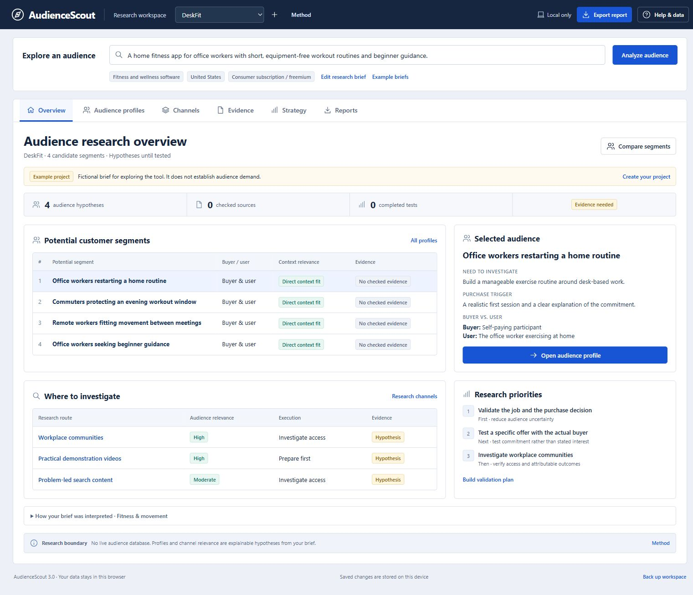
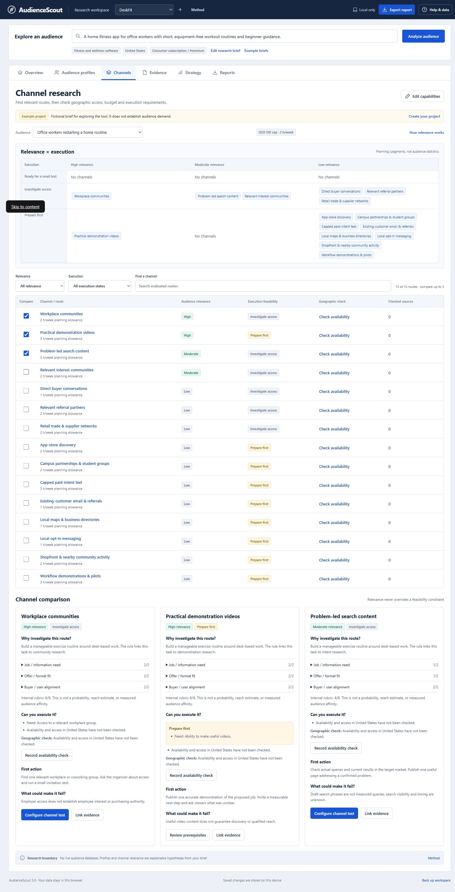
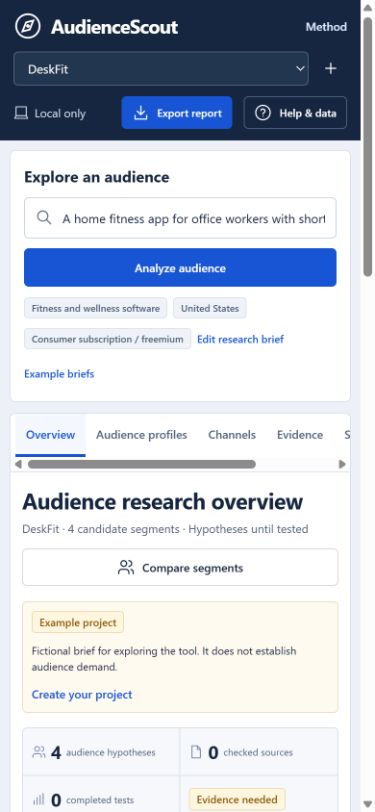

# AudienceScout V3

**Discover potential customers. Understand their needs. Choose what to test next.**

AudienceScout is a local audience research and marketing intelligence workbench for small businesses. Turn a product brief into specific customer hypotheses, compare marketing routes, organize supporting evidence, and plan practical validation experiments—all in your browser.

Start with your product and business context. Surveys and CSV imports are optional. No account, paid API, installation, or internet connection is required to use the ready-to-use application.

> **Research boundary:** AudienceScout generates explainable hypotheses from local rules. It does not query a live audience database, discover verified websites, or estimate market size, reach, conversion rates, or ROI. You supply and check the research evidence.



*Actual screenshot of the working V3 application. DeskFit is a fictional example brief; the screen explicitly shows zero checked sources and zero completed tests.*

[Quick start](#installation-and-launch) · [Features](#core-features) · [Workflow](#how-to-use-audiencescout) · [Evidence](#understanding-evidence-and-recommendations) · [Exports](#reports-and-backups) · [Troubleshooting](#troubleshooting)

## Who it is for

- **Small business owners and entrepreneurs** evaluating an offer, a local market, or their next marketing investment.
- **Founders and product teams** identifying purchase situations, separating buyers from end users, and testing demand before committing resources.
- **Marketers and consultants** comparing channels, documenting their reasoning, and preparing readable research reports.
- **Independent researchers** organizing interviews, response data, source checks, and validation results in one local workspace.

The workflow answers four questions: **Who could buy? What do they need? Where might you reach them? What should you test first?**

## Core features

| Workspace | What you can do | Practical output |
| --- | --- | --- |
| **Overview** | Analyze a product brief and inspect how it was interpreted | 3–5 candidate audiences, buying roles, research priorities, and evidence gaps |
| **Audience profiles** | Compare needs, pain points, motivations, interests, buying behavior, and information-source leads | Specific customer hypotheses with supporting reasoning and questions to investigate |
| **Channels** | Filter and compare routes by audience relevance, execution requirements, and geographic checks | A relevance/execution matrix and side-by-side channel explanations |
| **Evidence** | Record findings, add responses manually, import CSV/TSV, and prepare survey/interview guides | An evidence register with explicit source status and optional response statistics |
| **Strategy** | Review content opportunities and configure prioritized validation experiments | Test plans with spending caps, decision rules, actual results, and next steps |
| **Reports** | Export readable findings, response data, and complete project backups | Markdown, HTML, browser print/PDF, CSV, and JSON |

Projects are stored locally. V3 preserves existing response tools, edited research guides, validation records, and compatibility with earlier project backups.

## Business use cases

The built-in briefs demonstrate how different products lead to different research directions. These examples are hypotheses, not market findings.

| Business | Audiences to investigate | Marketing routes to investigate |
| --- | --- | --- |
| **Home fitness app for office workers** | People restarting a routine, commuters protecting an exercise window, remote workers, and beginners | Workplace communities, practical demonstration videos, and problem-led search content |
| **Personal budgeting app for university students** | Students planning term costs, managing a first independent budget, handling variable earnings, or saving for a specific expense | Campus groups, student communities, and task-specific content |
| **Inventory software for fruit shop owners** | Owner-operators, shops investigating stock loss, teams delegating stock work, and replenishment decision-makers | Direct buyer conversations, trade/supplier networks, and workflow demonstrations or pilots |
| **Local fruit retail business** | Household shoppers, people passing nearby, pickup/delivery customers where supported, and occasion-based buyers | Shopfront activity, local maps/directories, and neighbourhood communities |

Use **Example briefs** to explore these scenarios. Create a separate project for your own business.

## Installation and launch

### Ready-to-use application

1. Extract the supplied **AudienceScout-v3-ready-to-use.zip** using **Extract All** or your operating system's ZIP tool.
2. Open the extracted application folder and double-click **AudienceScout.html**.
3. If prompted, choose a current version of Edge, Chrome, Firefox, or Safari with JavaScript enabled.

**Success indicator:** the **Audience research overview** opens with the clearly labeled **DeskFit** example project.

There is no installer or local server. End users do not need Node.js, CMD, a terminal, an API key, or an account. The ready-to-use HTML contains the application code and styles.

If you already have the project folder, open **AudienceScout.html** directly. Keep it at the same path and use the same browser/profile for continued access to local projects. Browser handling of local-file storage varies; export JSON backups regularly.

### Optional static hosting

The provided **dist/index.html** is a self-contained static build that can be served by a static web host. Hosting is optional and is not configured by the application. Moving between a local file and a hosted URL changes the storage origin; use backup and restore to transfer projects.

## How to use AudienceScout

### 1. Describe the business

Choose **New project** using the plus button beside the project selector. Enter a product description, industry, target customer, concrete use cases, business model, geographic market, and business goals. For a local business, name the city or service area.

Separate **Who pays?** from **Who uses the product?** where appropriate. Choose a priority—demand, acquisition, retention, or awareness—and 3–5 candidate segments. Add your available budget, weekly hours, capabilities, and access if known. A blank resource value means unknown; zero means none. Budget is a total test cap in USD.

Select **Analyze research brief**.

**Success indicator:** customer hypotheses and initial channel leads appear without requiring any survey responses.

The prominent **Explore an audience** search updates the product description within the current saved context. For a different business, create a new project or edit the complete brief so its target, market, and business model stay consistent.

### 2. Review the potential customers

Expand **How your brief was interpreted** on Overview. Correct the brief or use the interpretation override if necessary.

Open **Audience profiles**, select a segment, and review its needs, buying role, purchase triggers, alternatives, interests, opportunities, and research questions. Treat proposed information-source categories as leads to investigate. They are not discovered websites or verified communities.

**Success indicator:** you can explain why a segment fits the product and identify the assumptions that still need evidence.

### 3. Compare marketing channels

Open **Channels** and choose an audience. Use the relevance and execution filters, search the evaluated routes, and compare up to three channels.

Read each channel's reasoning, requirements, first action, and possible failure conditions. Select **Record availability check** only after checking the actual service, community, or contact in the target market. Include a reference or check note, date, and geographic scope.

**Success indicator:** you have a shortlist and know which routes are ready for a small test, require access research, or need preparation.

<details>
<summary>View the actual channel research screen</summary>



*Actual full-page application capture using the fictional DeskFit brief. Relevance levels and rubric points are planning judgments; they are not measured audience affinity or predicted performance.*

</details>

### 4. Add evidence when available

Open **Evidence** to record a research finding, enter a response, import a CSV/TSV file, or edit a survey/interview guide. Link findings to the relevant audience and, optionally, a channel.

To mark a finding **Source-checked by you**, supply the original reference, what you checked, and a valid check date. Research and source checking happen outside the app. Edited guides can be saved and exported for use in those conversations.

**Success indicator:** observations, assumptions, source checks, and sample material remain visibly distinguishable.

### 5. Run a validation experiment

1. In **Strategy**, choose **Configure test**, or use **Configure channel test** from a channel card.
2. Adapt the hypothesis, method, metric, denominator, minimum observations, decision threshold, duration, and spending cap.
3. Save the plan, then use **Start test → Start & lock decision rule** before conducting the experiment outside the app.
4. Choose **Record results** and enter actual observations, successful outcomes, spending if applicable, and source/result notes.
5. Save the results and mark the test completed when appropriate.

**Success indicator:** the app calculates `successes / observations × 100`, checks the minimum observations, and compares the result with your pre-set rule. A result can be inconclusive, insufficient, meet the rule, or miss it.

Suggested thresholds are editable planning proposals. Outcomes do not establish statistical significance or population-wide demand. Started tests lock their decision fields; recorded results can be corrected with notes. Budget allocations are checked against the stated project cap, but the app does not control actual spending.

### 6. Export and back up

Open **Reports**, choose a readable report format, and download a JSON backup. Save open forms first: exports represent saved state.

**Success indicator:** the files appear in your browser's Downloads list and the report includes the reasoning, evidence status, and limitations.

<details>
<summary>View the actual mobile layout</summary>



*Actual mobile viewport capture of the working application. Scroll the horizontal tab bar to access additional analysis pages.*

</details>

## Understanding evidence and recommendations

### What the labels mean

| Label | Meaning |
| --- | --- |
| **System hypothesis** | A generated profile or recommendation based on the rules and your brief |
| **User-refined hypothesis** | Profile wording edited by you; still unverified |
| **User assumption** | A belief you have supplied for investigation |
| **User-reported observation** | A supplied finding that has not been source-checked |
| **Source-checked by you** | You inspected the original source and recorded its reference, check note, and date |
| **Stale link** | A related profile, source, or response changed or is missing; review is required |
| **Example / sample** | Fictional demonstration material, never real business evidence |

The app does not authenticate sources or independently verify their truth, representativeness, causality, or independence. Changing a linked profile, purchase role, or original response can invalidate its evidence link until reviewed again.

### How the rules work

AudienceScout interprets product function, industry, customer context, and use cases separately. Compound rules distinguish, for example, inventory software sold to a fruit shop owner from fruit sold to household shoppers. The engine proposes jobs, buying situations, and purchase roles rather than invented demographic personas.

Specialist scenarios cover office-worker fitness, student budgeting, fresh-produce inventory, local fruit retail, and learning. Other categories use explicit tasks and purchase roles with a visible specificity warning. This is a limited English rule system, not general language understanding; unusual wording, complex negation, or unsupported domains may need manual correction. Adjacent opportunities that depend on unstated capabilities are flagged.

**Audience relevance** evaluates job/information need, offer/format fit, and buyer/user alignment. Each contributes up to two rubric points: High = 5–6, Moderate = 3–4, Low = 0–2. These are disclosed planning judgments, not percentages, probabilities, or market measurements.

**Execution feasibility** separately checks assets, access, time, budget, product capabilities, scope, and geographic checks. High relevance does not override a missing prerequisite. Availability starts unknown in every country; a country name alone does not establish platform access. Changed markets make previous checks stale.

Only current source-checked links can adjust V3 channel relevance. At least two supporting source identifiers with more support than challenge add one point; more challenge than support subtracts one. Totals stay within 0–6. Repeated response IDs or normalized source references count once, and conflicting interpretations on one identifier count as mixed. Assumptions and raw response popularity do not change relevance. Read **Method** in the app for the full explanation.

## Importing research responses

1. In **Evidence**, find Responses and download the **CSV template**.
2. Add one respondent per row and save as UTF-8 CSV or TSV.
3. Choose **Import CSV**, select the file, and check the column mapping.
4. Select **Review import**. Inspect valid rows, duplicates, and errors; download the error list if needed.
5. Select **Import N valid responses** to save the accepted rows.

**Success indicator:** the imported count and responses appear. No rows are saved before confirmation, and parsing takes place in your browser.

| Column | Expected content |
| --- | --- |
| `respondent`, `segment` | Optional anonymous identifier and respondent group |
| `needs`, `painPoints`, `interests`, `motivation`, `notes` | The respondent's answers or research context |
| `channels` | Semicolon-separated values, such as `Email; LinkedIn` |
| `intent` | Whole number 1–5; blank for unanswered or not sure |
| `method` | `survey`, `interview`, or `other` |
| `date` | Optional valid `YYYY-MM-DD` date |
| `source` | `real` or blank; `sample` is rejected in research projects |

Quote fields containing commas, quotes, or line breaks using standard CSV quoting. At least one substantive answer, channel, note, or intent value is required. Duplicate full response contents are skipped; respondent ID alone is not a uniqueness key. Use `None` only for an explicit lack of channel preference, without other channels in that response.

Imports support up to **5 MB and 5,000 rows** each, with **10,000 responses per project**. Browser storage may impose a lower practical limit.

Response charts describe the supplied records only. Channel percentages use respondents who answered that question; multiple selections may total more than 100%. Missing answers are shown separately. Mean stated intent is not purchasing behavior. The Everyday Coffee and Studio Flow sample datasets each contain 24 fictional responses and remain labeled as examples.

## Reports and backups

| Export | Included content / purpose |
| --- | --- |
| **Markdown / HTML** | Profiles, buyer/user roles, reasoning, information-source leads, selected-audience channel comparisons, constraints, content ideas, validation plans/results, evidence, and limitations |
| **Print / PDF** | A printable report; choose **Save as PDF** in the browser's print dialog |
| **Download CSV** | Original responses for the selected scope; spreadsheet formula-like cells are protected |
| **Back up project / Back up all** | Complete JSON project data, including context, answers, edited guides, availability checks, findings, profile edits, tests, notes, and earlier checklists |
| **Restore backup** | Preview and restore v1/v2/v3 JSON backups up to 15 MB as additional projects |

HTML reports can be read without opening AudienceScout. PDF generation depends on the browser's native printing support.

### Storage and privacy

Saved projects stay in the current browser/profile. The app has no account system, analytics, remote file processing, or automatic data upload. Its application Content Security Policy disables network connections; an external reference opens only if selected.

Browser storage is not a backup. Private browsing, clearing site data, changing browsers, moving the HTML file, or changing the hosted origin may make projects unavailable. AudienceScout does not encrypt local data or exports. Use anonymous respondent IDs where possible and review exported content before sharing.

### Upgrading from an earlier version

1. In the old app, select **Reports → Back up all** and retain the JSON file.
2. Keep a copy of the old HTML, then replace the working **AudienceScout.html** at the same path.
3. Open V3 in the same browser/profile. Existing projects use the original storage key.
4. Use **Edit research brief** to add V3 context. Older projects retain their previous analysis behavior until this brief is saved.
5. If projects are not visible, choose **Reports → Restore backup**, review the file, and select **Restore projects**.

**Success indicator:** original responses, edited guides, notes, and recorded tests remain available. Restored copies have **(restored)** in their names and do not replace existing projects.

V3 accepts schema 1, 2, and 3 backups. New saves use schema 3, which older releases cannot read. Keep the pre-upgrade backup and avoid alternating old and new releases against one workspace.

## Troubleshooting

| Symptom | What to do |
| --- | --- |
| Blank page | Extract the ZIP, enable JavaScript, and open **AudienceScout.html** in a current browser. |
| No profiles or an unsuitable interpretation | Complete the required brief fields, inspect the interpretation, and refine the product function or purchase roles. Use the override when needed. |
| A channel requires preparation | Read its assets, time, budget, scope, and availability requirements. |
| A finding or availability check is stale | Inspect the changed source, profile, or market and save a fresh review. |
| Projects disappear after moving the file | Return to the original browser/profile/path or restore a JSON backup. |
| Session-only storage warning | Export before closing and use a regular browser profile with storage enabled. |
| Another window changed the workspace | Reload before editing to avoid overwriting newer work. |
| Storage is full or unreadable | Keep the current form open, export available recovery data or backups, and follow the recovery dialog before retrying. |
| A download or PDF does not appear | Check browser download/print permissions. Try HTML or Markdown export if printing is unavailable. |

## For developers

End users can skip this section. The source is dependency-free JavaScript, HTML, and CSS; no package installation is required. With Node.js available, run these commands from the `audiencescout` folder:

```sh
node --test tests/*.test.cjs
node build.cjs
```

The build writes **AudienceScout.html** and an identical **dist/index.html**. It does not require a server or external runtime libraries.

| Files | Responsibility |
| --- | --- |
| `core.js` | CSV/response handling, aggregates, sample datasets, and base questions |
| `discovery.js` | Preserved V2 logic, migration, evidence validation, and test lifecycle |
| `research-rules.js`, `intelligence.js` | Contextual scenarios, purchase roles, channel logic, feasibility, strategy, reports, and planner |
| `views.js`, `app.js` | Views, events, storage, dialogs, imports, and exports |
| `workbench.js`, `workbench.css` | V3 dashboard, navigation, profiles, comparison tables, filters, and responsive layout |
| `styles.css`, `discovery.css` | Shared and preserved component styles |
| `tests/`, `build.cjs` | Automated checks and standalone build generation |

V3 release validation passed **97 automated tests**, covering the four business cases, buyer/user roles, calculations, geography, evidence status and staleness, test outcomes, CSV handling, migrations, and storage recovery/conflicts. Browser QA exercised desktop/mobile navigation, briefs, profiles, filters, findings, responses, imports, guides, validation, reload, reports, and backup restoration with synthetic data. Native double-click launching and browser PDF dialogs require a check in the user's chosen browser.

The screenshots embedded above are real captures from that working application, retained in `docs/screenshots/`. They are not mockups or generated images.

## Design reference

The search-led workflow, horizontal analysis tabs, ranked research surfaces, and connection between research and action were informed by [SparkToro's public site](https://sparktoro.com/) and [its audience-description workflow](https://sparktoro.com/blog/starting-today-anyone-can-analyze-any-describable-audience-in-sparktoro/). AudienceScout has original branding and local analysis rules. It does not include SparkToro data or API access.
